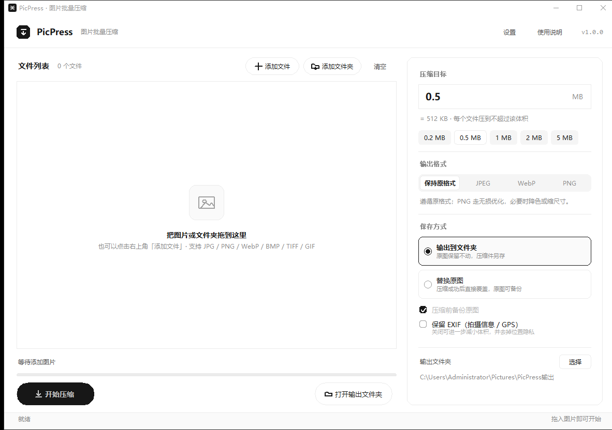
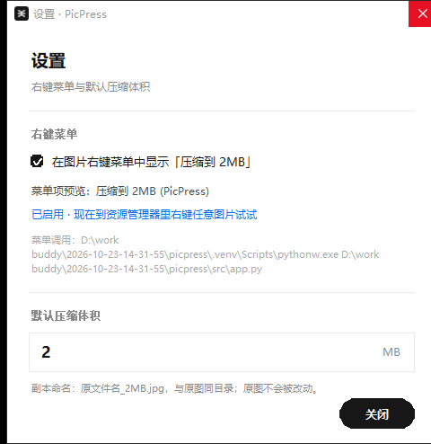
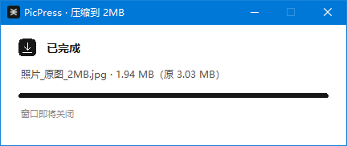

# PicPress

> 按**目标体积**压缩图片的 Windows 小工具：填一个 MB 数，它就把图片压到那个尺寸以内，并尽量保住画质。
>
> A Windows batch image compressor that hits an **exact file-size target** instead of a fixed quality value.




---

## 为什么是「按体积」而不是「按质量」

绝大多数压缩工具让你拖一个质量 0–100 的滑块，但真正卡住人的从来不是质量数字，而是体积上限：报名表要求 2MB 以内、邮件附件 25MB 以内、图床单图 5MB 以内。

PicPress 反过来解这道题：**给定目标体积，倒推该用什么参数**。二分搜索质量参数，压不进去就分级缩小分辨率，最后取「能塞进目标体积的最高画质」。

实测（1200 万像素噪声图，最坏情况）：

```
目标 0.3 MB    alpha.png   384.4 KB →  72.0 KB   256 色 · 缩至 90%
              flat.bmp      5.61 MB →  16.3 KB   无损 · 转 PNG
          photo_big.jpg     7.59 MB → 291.3 KB   q95 · 缩至 28%
               tiny.jpg     5.65 KB →   5.65 KB   已达标，未重压
```

---

## 功能

- **压到指定体积**：输入 MB 数或用 0.2 / 0.5 / 1 / 2 / 5 MB 预设，结果是「不超过」而不是「大约」。
- **批量处理**：拖文件夹进来递归收集，4 线程并行，列表逐行实时出结果。
- **资源管理器右键**：右键任意图片 → 压缩到 2MB，同目录生成 `原文件名_2MB.jpg` 副本，原图不动。
- **三种保存方式**：输出到指定文件夹 / 替换原图（可自动备份）/ 只生成副本。
- **格式与透明**：保持原格式，或统一转 JPEG / WebP / PNG；转 JPEG 时透明区自动铺白底。
- **EXIF 可剥离**：默认移除拍摄信息与 GPS（顺便减小体积），也可保留。
- **不重复劳动**：原图本来就小于目标时直接跳过，不重压、不掉画质。

---

## 快速开始

### 下载即用

到 [Releases](../../releases) 下载，解压后双击 `PicPress.exe`。

> 发布包分两种：
> - **文件夹版**（推荐）：启动约 0.6 秒，右键菜单用它体验最好。
> - **单文件版**：只有一个 exe，方便携带，但每次启动要解包，约 3–4 秒。

### 从源码运行

```bash
pip install -r requirements.txt
python src/app.py
```

需要 Python 3.10+，且该 Python 自带 tkinter（Windows 官方安装包默认勾选）。

### 自己打包

```bash
python build.py          # 同时产出文件夹版与单文件版
python build.py dir      # 只打包文件夹版
python build.py file     # 只打包单文件版
```

产物在 `dist/`。

---

## 右键菜单

主界面右上角 **设置** → 勾选「在图片右键菜单中显示」，即刻生效，无需管理员权限。



实现上只写 `HKCU\Software\Classes\SystemFileAssociations\.<ext>\shell`，覆盖 jpg / jpeg / png / webp / bmp / tif / tiff / gif，写完调用 `SHChangeNotify` 让资源管理器立即刷新，不用重启桌面。



几个行为细节：

| 场景 | 表现 |
|---|---|
| 选中多张图片 | 只弹一个窗口，按顺序处理完（靠命名互斥量 + 临时队列合并进程） |
| 原图小于目标体积 | 按字节原样复制一份副本，不重压 |
| 副本已存在 | 自动编号为 `照片_2MB(2).jpg`，绝不覆盖 |
| 移动了程序目录 | 下次打开程序会自检并把菜单指向新位置 |

也可以静默注册：

```bash
PicPress.exe --install-menu 2       # 注册为「压缩到 2MB」
PicPress.exe --uninstall-menu       # 移除右键菜单
```

---

## 命令行

```bash
PicPress.exe --cli 照片目录 --target 0.5 --out D:\输出
PicPress.exe --cli a.jpg b.png --target 2 --fmt webp --log result.txt
```

| 参数 | 说明 |
|---|---|
| `--target` | 目标体积，单位 MB（默认 0.5） |
| `--out` | 输出目录；不填则输出到源文件旁的 `PicPress输出` |
| `--fmt` | `keep` / `jpeg` / `webp` / `png` |
| `--replace` | 压缩后替换原图 |
| `--no-backup` | 替换时不备份（默认备份） |
| `--keep-exif` | 保留 EXIF |
| `--log` | 把结果写入文本文件 |

窗口版 exe 没有控制台，所以命令行的中文输出建议用 `--log` 落盘再看。

---

## 压缩原理

核心在 [`src/compressor.py`](src/compressor.py)，思路是三层收敛：

1. **探测**：先用最低成本的一次编码估算体积。体积大致与像素数成正比，于是按面积比的平方根直接跳到最可能的缩放档位，省掉大段无用编码。
2. **二分质量**：在选定的分辨率上二分 `quality`（1–95），取「不超过目标」的最大值。
3. **分级退让**：若该分辨率下质量已经低到画质明显劣化，就按 `1.0 → 0.9 → 0.78 → 0.64 → 0.5 …` 逐级缩小再试，直到质量落到可接受区间。

PNG 是无损格式，没有质量参数，走另一条路：**无损重压 → 调色板降色**（256 / 192 / 144 / 96 / … / 8 色，从高往低试，命中即停），实在不行才缩尺寸。

几个工程上的取舍：

- **优先保分辨率**：只有原尺寸下质量已经低于 40 分才考虑缩图。用户说「压到 2MB」时，通常希望尺寸不变。
- **编码档位按像素量自适应**：WebP 的 `method=6` 在 1200 万像素图上比 `method=0` 慢 13 倍却只小 5%，所以按像素量分档（≤80 万用 6，≤150 万用 4，≤800 万用 2，更大用 0）。PNG 的 `optimize=True` 同理。
- **动图单独处理**：多帧 GIF 转 WebP 动图，用画质阶梯而非二分（每帧都要编码，二分太贵）。

---

## 数据安全

图片是用户的原件，所以所有写盘路径都按「宁可失败，不可丢数据」设计：

- **默认不碰原图**：输出到独立目录 / 生成带后缀的副本。
- **替换模式的原子性**：先写 `.pptmp` 临时文件，落盘成功后再 `os.replace` 覆盖。
- **备份先行**：替换前把原件复制到 `~/PicPress备份/<时间戳>/`；**备份失败就拒绝覆盖**。
- **扩展名变化**：PNG → JPEG 时先写新文件、再删旧文件，中途任何失败都不影响原件。

---

## 支持格式

| 输入 | 说明 |
|---|---|
| `.jpg` `.jpeg` | 主场景，质量二分 |
| `.png` | 无损优先，必要时降色或缩尺寸 |
| `.webp` | 有损 / 无损都走质量二分 |
| `.bmp` `.tif` `.tiff` | 转 PNG 输出（原容器无法有效压缩） |
| `.gif` | 多帧转 WebP 动图；单帧按 PNG 处理 |

---

## 已知限制

- 仅 Windows（右键菜单、拖拽、DPI 适配都基于 Win32 API）。
- 右键菜单靠 exe 路径调用，**移动程序目录后需要重新打开一次程序**才能自动修正指向。
- 单文件版启动较慢（PyInstaller 每次启动都要解包），需要秒开请用文件夹版。
- 界面为 tkinter 自绘，不支持系统深色模式（固定浅色）。
- 未做图片旋转/裁剪等编辑功能，只解决「体积」这一件事。

---

## 目录结构

```
src/
  app.py         主界面 + 设置窗口 + 命令行入口（tkinter 自绘控件）
  compressor.py  压缩引擎（纯逻辑，可独立调用与测试）
  quick.py       右键快速压缩窗口（含单实例队列）
  shellmenu.py   资源管理器右键菜单注册
tools/           开发期工具：截图、布局诊断、交互与右键流程测试
test_engine.py   引擎回归测试（造图 → 压到指定体积 → 断言不超标）
test_replace.py  替换原图模式的安全性测试
build.py         PyInstaller 打包脚本
make_icon.py     用 Pillow 矢量绘制应用图标
```

---

## License

[MIT](LICENSE)
